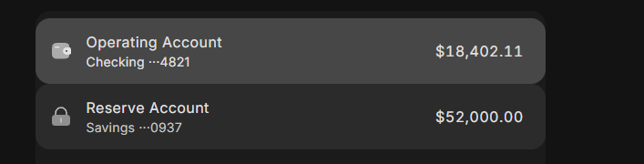
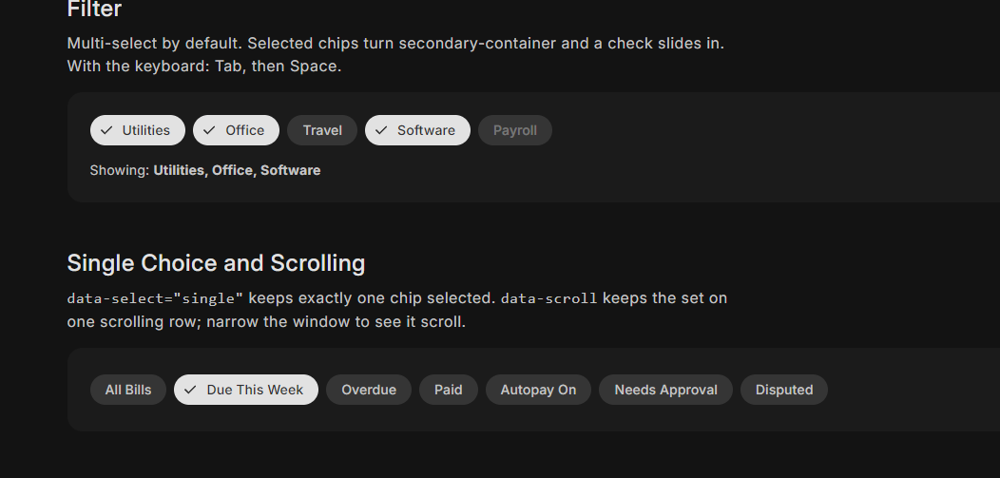

# Open issues

The owner's critiques, waiting to be worked on. Each has a reference image in `img/`; open the image before starting the
issue. When an issue is done, move it to "Done" with the commit and decision number.

Goal across all of them (owner, 2026-11-14): **look good on both desktop and mobile** (check at 390 and 1280, light and
dark, and ask for an iPhone look).

**First step for all motion issues: a motion lab** ([`explore/motion-liquid.html`](../../explore/motion-liquid.html), answered 2026-11-14, see [0042](../decisions/0042-liquid-ink-motion.md); round 2: [`explore/motion-liquid-2.html`](../../explore/motion-liquid-2.html) for row hover, radio, menu and speed) (owner, 2026-11-14) to confirm that what's built matches what the
owner means by "liquid but subtle", before any motion issue is built. Show each candidate (liquid row hover 7, bending
chevron 11, liquid radio 19, snackbar 28, tooltip 29, menu 31, progress 26/27, skeleton 25) with the scrubber, plus
today's motion for comparison, and ask if the owner needs to explain it differently.

**Motion direction (owner, 2026-11-14):** the general animation theme should be **super subtle but liquidy**, with small
interesting moments (a shape that flows, an icon that bends into the next one) instead of plain fades and spins. Quick
enough to never be in the way, but never looking instant. This amends 0022 (simpler motion): keep its sturdiness rules
(transform and opacity, one transition per element, nothing cloned) unless the owner agrees otherwise; record as a new
decision and show options in a motion lab with the scrubber before building.

## Open (2026-11-14)

Issues 1 to 6, 8 to 10, 12 to 18, 20 to 23 and 32 to 35 were built in the overhaul (decision 0043) and wait for the owner's look in the [Overhaul Review](../../explore/review-orion-2.html). Still open: 7 and idea A.

### 7. Liquid hover between list rows (owner reviews on a computer)
**Reminder for the owner: review the row hover options on a computer** ([Lab 2](../../explore/motion-liquid-2.html), question 1: Today, Edges Settle, Edges Lean, Corners Melt) and say which one, or describe it. Owner's direction so far: a minor animation of the hover box's edges, not a box that travels between rows.
Original note: moving the pointer from one row to the next should feel liquid: the hover/selection shape flows to the next row and its
rounded corners morph as it goes (like the sliding nav pill, but softer). Subtle. Applies to lists and similar rows.

### 24. ~~Banner on glass~~ (scrapped)
Scrapped by the owner (2026-11-14): they meant snackbars, not banners. Banners stay solid content. See issue 28.

### A. Whatever you touch turns into glass
Owner's "crazy side idea" (2026-11-14), to spend real time on: anything you touch or that is active becomes glass. A
selected chip turns into glass (keeping its selected color, just on a different surface), a focused text field turns
into glass, with an animation between the two. Maybe glass has several states (resting, touched, selected) and this is
a middle phase between solid and full glass. Questions to explore: does it keep text contrast (extend check-glass to
tinted states)? Does it read on a solid content surface with nothing interesting behind it? Is it consistent with
"content is solid" (0004)? Try it in a lab on chips, fields, list rows and buttons before deciding anything.

## Done

- **1.** Rail collapse animation glitches: done 2026-11-14 (rail is rows; only its edge moves, decision 0043).
- **2.** Duotone icons turn completely white when selected: done 2026-11-14 (selected icons keep both tones, decision 0043).
- **3.** Rail items on desktop: label beside the icon, hamburger menu button: done 2026-11-14 (rows with the label beside the icon, hamburger, solid main action, decision 0043).
- **4.** Solid controls on glass look out of place: done 2026-11-14 (items on glass are tints, proven by check-glass, decision 0043).
- **5.** Duotone icon tones are too close together: done 2026-11-14 (faded tone 0.42 / 0.38, decision 0043).
- **6.** Selected list rows touch the side edges but not the top: done 2026-11-14 (lists inset on every side, decision 0043).
- **8.** Switch hover looks bad; no hover halo: done 2026-11-14 (no halo; the handle grows a little, decision 0043).
- **9.** No glass on tables: done 2026-11-14 (flat rows, solid header, thin scrollbar, decision 0043).
- **10.** Table row hover looks bad: done 2026-11-14 (flat band, no checkbox halo, decision 0043).
- **12.** Composer send button height looks bugged: done 2026-11-14 (the composer is one pill, decision 0043).
- **13.** Press-to-square only where it fits: done 2026-11-14 (buttons stay round inside rounded containers, decision 0043).
- **14.** Selects must open the glass menu: done 2026-11-14 (the reference page loads the menu script, decision 0043).
- **15.** A real date picker: done 2026-11-14 (glass calendar with range, keyboard and a phone panel, decision 0043).
- **16.** Error fields: the red is too intense: done 2026-11-14 (normal fill; label, message and ring carry the error, decision 0043).
- **17.** Selected chips must not change size: done 2026-11-14 (chips keep one size; options in the Overhaul Review, decision 0043).
- **18.** Checkbox marks are too big: done 2026-11-14 (thin small marks, decision 0043).
- **20.** Slider must reach both ends: done 2026-11-14 (the handle travels the whole track, decision 0043).
- **21.** No stop dot peeking out under the handle: done 2026-11-14 (dots near the handle and at the ends are hidden, decision 0043).
- **22.** Color: normal, contrast-safe colors; accents stay accents: done 2026-11-14 (neutral surfaces, accent only on accents; options in the Overhaul Review, decision 0043).
- **23.** Badges look washed out in dark mode: done 2026-11-14 (one red badge in both modes, decision 0043).
- **32.** Don't autofocus fields in dialogs and sheets: done 2026-11-14 (the dialog takes focus, never a field, decision 0043).
- **33.** Field focus ring on glass feels off: done 2026-11-14 (hover fill stays during focus; fields on glass are tints, decision 0043).
- **34.** Replace bottom and side sheets with floating glass panels: done 2026-11-14 (floating glass panels, decision 0043).
- **35.** Side sheet: no edge glow down the side: done 2026-11-14 (panels float clear of every edge, decision 0043).
- **11.** Accordion: too fast, chevron should bend, not spin: done 2026-11-14 (accordion reveal + bending chevron, decision 0042).
- **19.** Radio: liquid selection, no inner dot: done 2026-11-14 (ink fill, no dot (window idea dropped by the owner), decision 0042).
- **25.** Skeleton: glitchy, and a wave instead of a blink: done 2026-11-14 (one sheen wave, decision 0042).
- **26.** Circular progress: 100% is a full circle; a more creative indeterminate: done 2026-11-14 (full ring, breathing arc, decision 0042).
- **27.** Linear progress: full at 100%, creative indeterminate, a realistic download demo: done 2026-11-14 (full bar, drop-like line, download demo on the progress page, decision 0042).
- **28.** Snackbars on glass, with a liquid arrival: done 2026-11-14 (glass, rises 14px, decision 0042).
- **29.** Tooltips: a bit faster and a better entrance: done 2026-11-14 (glass, rises 4px, appears after 350ms, decision 0042).
- **30.** Rich tooltips: rounder, with room around the action: done 2026-11-14 (extra-large corners, room around actions, decision 0042).
- **31.** Menus in the new motion style: done 2026-11-14 (items follow, decision 0042).
