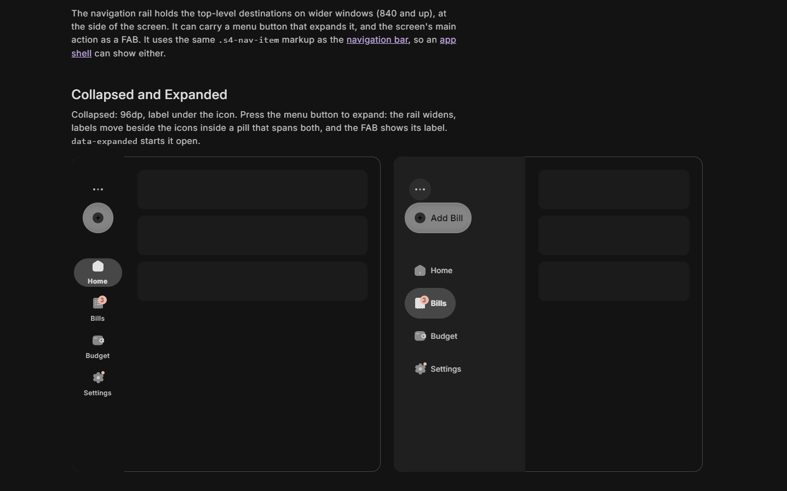
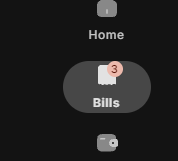
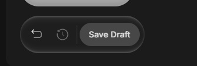
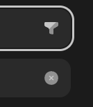
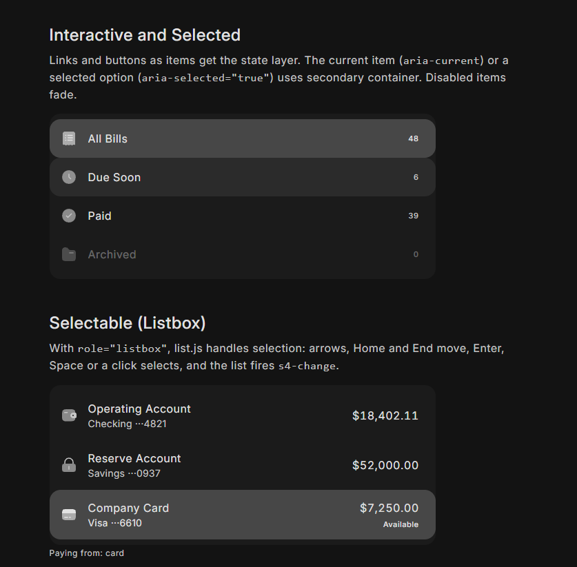
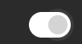
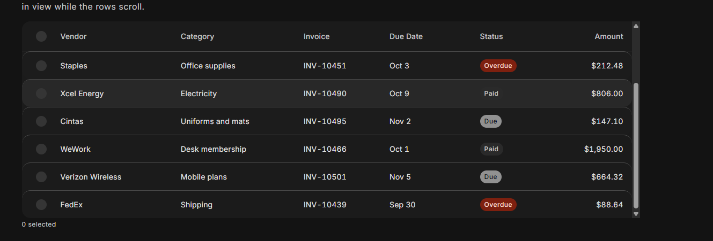
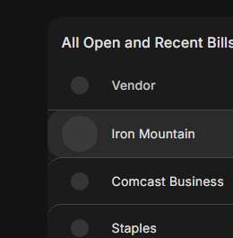
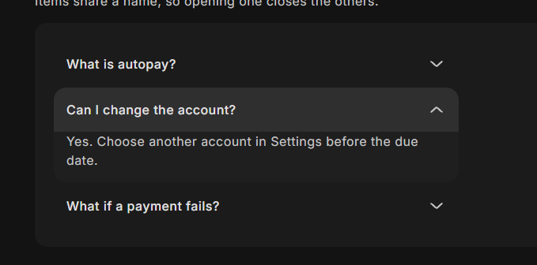

# Open issues

The owner's critiques, waiting to be worked on. Each has a reference image in `img/`; open the image before starting the
issue. When an issue is done, move it to "Done" with the commit and decision number.

Goal across all of them (owner, 2026-11-14): **look good on both desktop and mobile** (check at 390 and 1280, light and
dark, and ask for an iPhone look).

**Motion direction (owner, 2026-11-14):** the general animation theme should be **super subtle but liquidy**, with small
interesting moments (a shape that flows, an icon that bends into the next one) instead of plain fades and spins. Quick
enough to never be in the way, but never looking instant. This amends 0022 (simpler motion): keep its sturdiness rules
(transform and opacity, one transition per element, nothing cloned) unless the owner agrees otherwise; record as a new
decision and show options in a motion lab with the scrubber before building.

## Open (2026-11-14)

### 1. Rail collapse animation glitches
Collapsing the expanded navigation rail with its animation shows a visual bug (labels and pill during the width change).
Reproduce on `components/nav-rail/nav-rail.html` (press the menu button to expand, then collapse) with the scrubber.

### 2. Duotone icons turn completely white when selected
Some duotone icons lose their two tones on a selected item (here Bills in the rail: the icon is a flat white shape).
Check every selected or pressed state that sets the icon color (nav bar, rail, chips, list, segments, menu).

### 3. Rail items on desktop: label beside the icon, hamburger menu button
On desktop the rail items should be normal rows with the label next to the icon (not stacked under it), like a standard
side navigation. The rail's menu button becomes a **hamburger** icon (today it's dots). Owner's exception to "Bold
Duotone only": in places like this a **Line Duotone** icon is fine. Also see the grey-disc FAB in the collapsed rail
(question 3 of the framework review). Needs a decision record (amends 0007 and the rail docs).

### 4. Solid controls on glass look out of place
Where a transparent (glass) surface holds a solid, selectable thing (a toolbar's Save Draft button, the nav bar's
selected pill, icons and clear buttons in fields on glass), the solid fill looks pasted on. Make items on glass look
like they belong (revisit 0015 "items on glass keep their own color" with the owner; keep the contrast guarantee and
extend `check-glass` to whatever fill is chosen).

### 5. Duotone icon tones are too close together
In general the two tones of the duotone icons are too similar, which hurts contrast and readability. Raise the
difference between the base and the accent tone (check against the surfaces they sit on, light and dark).

### 6. Selected list rows touch the side edges but not the top
In lists (and similar places) the selected or hovered fill runs to the left and right edges of the container while
there is a gap at the top, which looks odd. Inset the selection evenly (padding or margin on all sides) so the fill
never touches only some edges.

### 7. Liquid hover between list rows
Moving the pointer from one row to the next should feel liquid: the hover/selection shape flows to the next row and its
rounded corners morph as it goes (like the sliding nav pill, but softer). Subtle. Applies to lists and similar rows.

### 8. Switch hover looks bad; no hover halo
The switch's hover state looks wrong, and the owner doesn't like the round hover "shadow" (state-layer halo) around the
handle. Find a cleaner hover (for example a slight handle or track change) for switches, and check the other controls
that draw the same halo (checkbox, radio, slider handle).

### 9. No glass on tables
The table (sticky header, scroll area) looks like it's trying to be glass; it looks bad. Tables are content and stay
solid: remove any glass or translucency from the table and its sticky header.

### 10. Table row hover looks bad
Hovering a row draws a fill with odd rounded edges and a big halo around the row checkbox. Make the row hover clean
(and consistent with issue 6's even inset and issue 7's liquid hover).

### 11. Accordion: too fast, chevron should bend, not spin
Opening and closing feels too fast; it should be quick but never look instant. The chevron should **bend** into the
other direction, like bending a book backward (a flip around its horizontal axis), not rotate. The owner wants this
kind of interesting but subtle animation elsewhere too (see the motion direction above).

## Done

(none yet)
